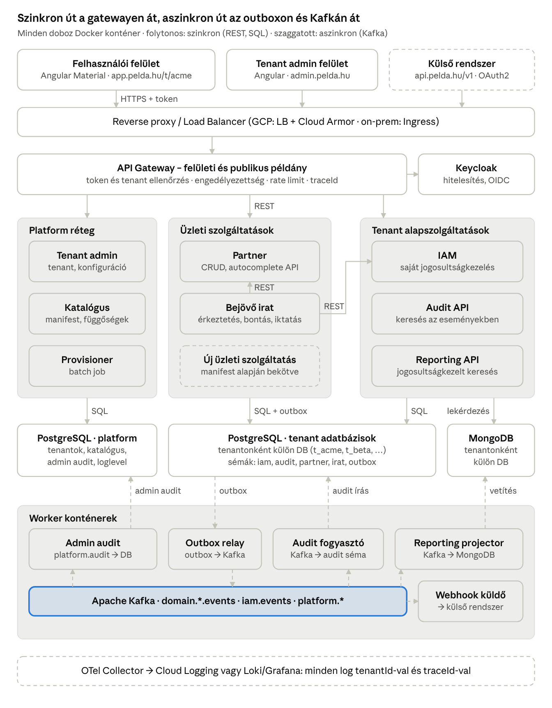
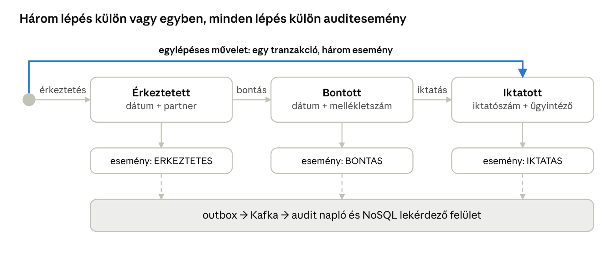

# Multi-tenant SaaS üzleti alkalmazás keretrendszer – architektúra terv

2026. október 26. · Yanoo

> Élő változat (szerkeszthető, kommentelhető): https://claude.ai/artifact/XuUSCQqGyeEENrL1Pjrexi

## Összefoglaló és fő döntések

A keretrendszer konténerizált, felhőfüggetlen multi-tenant platform: ugyanazok a Docker image-ek futnak SaaS-ként Google Cloud Run-on és ügyfélnél on-premise (Kubernetes vagy Docker Compose). Tenantonként külön PostgreSQL és külön NoSQL adatbázis van; minden adatváltozás tranzakciós outboxon keresztül Kafkára kerül, onnan táplálkozik az audit napló és a reporting. A jogosultságkezelés a saját IAM szolgáltatásban van, nem függ a felhő IAM-től.

| Terület | Döntés | Indoklás |
| --- | --- | --- |
| Futtatás | Minden komponens Docker image; GCP-n Cloud Run, on-prem Kubernetes (Helm chart) vagy Docker Compose | Egy build, több célkörnyezet; a SaaS és az on-prem verzió nem válik szét |
| Frontend | Angular + Angular Material SPA, Native Federation alapú micro-frontendek, nginx konténerben | Teljesen elkülönül a backendtől, csak REST/JSON API-n kommunikál |
| Backend | Java 21 + Spring Boot 3 mikroszolgáltatások, közös „platform starter” könyvtárakkal, 12-factor konfiguráció | Tenant-kezelés, jogosultság, audit, outbox, naplózás egyszer készül el; környezetfüggő beállítás csak környezeti változóból |
| Tranzakciós adat | PostgreSQL, **tenantonként külön adatbázis**, azon belül szolgáltatásonként külön séma (GCP-n Cloud SQL, on-prem saját PostgreSQL) | Teljes adatelkülönítés, tenantonként mentés, visszaállítás és törlés |
| Lekérdezés, kimutatás | MongoDB, **tenantonként külön adatbázis** (GCP-n Atlas, on-prem MongoDB Community vagy Enterprise) | Denormalizált, kereshető read modellek; rugalmas séma a szolgáltatásonkénti riportokhoz |
| Csomagütemező | **Apache Kafka** (GCP-n Managed Service for Apache Kafka, on-prem Kafka KRaft módban) | Egy eseményt több fogyasztó olvas; visszajátszható, így a NoSQL bármikor újraépíthető; kulcs szerinti sorrendtartás |
| Hitelesítés | **Keycloak** (OIDC), tenantonként külön realm; on-prem az ügyfél AD/LDAP címtárához köthető | Nyílt forrású, konténerben fut, nem kötődik felhőszolgáltatóhoz |
| Jogosultság | **Saját IAM szolgáltatás**: jogosultsági elemek, hozzárendelések, effektív jog számítása a tenant adatbázisában | Független a GCP IAM-től és a Keycloak szerepköreitől is; a Keycloak csak azt mondja meg, ki a felhasználó |
| Naplózás | Strukturált JSON log + OpenTelemetry, OTel Collectoron át a környezet loggyűjtőjébe (GCP-n Cloud Logging/Trace, on-prem Grafana Loki/Tempo) | Egy helyen kereshető minden log; a `traceId` fűzi össze a szolgáltatásokon átívelő műveletet |
| Integráció | Publikus, verziózott REST API (OpenAPI 3.1) külön gateway-példányon, OAuth2 client credentials, webhookok | Külső szoftverek stabil szerződéssel csatlakoznak; ugyanaz a jogosultsági modell, mint a felhasználóknál |

Miért Kafka és nem RabbitMQ: a reporting szinkronhoz és az audithoz ugyanazt a CRUD eseményt több független fogyasztó olvassa, és egy új riport vagy hibás vetület esetén az eseményeket újra le kell tudni játszani. Ezt a Kafka natívan tudja, RabbitMQ-val külön eseménytárat kellene építeni.

## Rendszerarchitektúra



Felülről lefelé: a kérés a load balanceren és a gatewayen át jut a szolgáltatásokhoz, amelyek a tenant saját PostgreSQL adatbázisába írnak; minden írás outbox sort is képez. Alul az aszinkron ág: az outbox relay Kafkára tesz, ahonnan az audit és a reporting projector egymástól függetlenül dolgoz fel. A Bejövő irat szinkron REST-tel kérdezi a Partnert (partner választás) és az IAM-et (ügyintéző választás).

## Multi-tenant modell és URL-struktúra

Minden kérés tenant-kontextusban fut: a tenant kódja az URL-ből érkezik, a gateway ellenőrzi, hogy egyezik a JWT-ben lévő tenanttal, és a szolgáltatás ez alapján választja ki a tenant adatbázisát.

### Adatszeparáció

| Réteg | Elkülönítés | Megvalósítás |
| --- | --- | --- |
| PostgreSQL | Tenantonként külön adatbázis (`t_<tenantkod>`), saját DB-felhasználóval | Sémák szolgáltatásonként: `iam`, `audit`, `partner`, `irat`, `outbox`; Flyway migráció sémánként |
| PostgreSQL (platform) | Külön `platform` adatbázis | Tenant törzs, tenant konfiguráció, szolgáltatás-katalógus, tenant admin felhasználók, admin audit |
| MongoDB | Tenantonként külön adatbázis (`rpt_<tenantkod>`), saját DB-felhasználóval | Kollekciók szolgáltatásonként, pl. `irat_kuldemeny`, `partner_partner` |
| Kafka | Közös topicok, a `tenantId` kötelező fejléc és az üzenetkulcs része | A fogyasztók a fejléc alapján választanak adatbázist; nagy ügyfélnek opcionálisan dedikált topic |
| Identitás | Keycloak realm ügyfelenként | Egy tenant felhasználója másik tenantba nem tud belépni |
| Log | Közös loggyűjtő (Cloud Logging vagy Loki), `tenantId` minden logsorban | Supportnak egy helyen kereshető, tenantra szűrhető |

A backendben a tenant-kontextust egy közös `TenantContext` hordozza (request scope, Kafka fogyasztáskor a fejlécből töltve). Az adatbázis-választást egy `AbstractRoutingDataSource` végzi, tenantonként lustán létrehozott, kis méretű HikariCP poollal. Sok tenant és sok Cloud Run példány esetén a kapcsolatszám a szűk keresztmetszet, ezért a pool méretét és a példányszám felső korlátját együtt kell méretezni, szükség esetén kapcsolat-pooler (PgBouncer vagy a Cloud SQL managed connection pooling) kerül elé.

### URL-struktúra

| URL | Mi töltődik be |
| --- | --- |
| `https://app.<domain>/` | Tenant választó: tenant kód megadása, vagy a böngészőben megjegyzett, korábban használt tenantok listája |
| `https://app.<domain>/t/{tenant}` | A tenant login képernyője (ha nincs érvényes munkamenet), különben a kezdőlap |
| `https://app.<domain>/t/{tenant}/{szolgaltatas}/...` | Szolgáltatás felületei, pl. `/t/acme/irat/erkeztetes`, `/t/acme/partner/lista` |
| `https://app.<domain>/api/t/{tenant}/{szolgaltatas}/...` | Backend API ugyanezzel a tenant-szegmenssel |
| `https://admin.<domain>/` | Tenant admin felület, külön belépéssel |
| `https://api.<domain>/v1/t/{tenant}/{szolgaltatas}/...` | Publikus integrációs API külső rendszereknek (OAuth2 client credentials) |

A tenant választó nem listázza ki az összes ügyfelet, mert az ügyfélnév-lista önmagában érzékeny adat; a felhasználó a tenant kódot írja be, vagy az utoljára használtak közül választ. Inaktív vagy nem létező tenant kódra ugyanaz a semleges hibaüzenet jön.

## Platform réteg: tenant admin szolgáltatás

A tenant admin a platform „vezérlősíkja”: külön alkalmazás (`admin.<domain>`), külön Keycloak realmmel és a `platform` adatbázissal, ügyféladathoz nem fér hozzá.

| Funkció | Tartalom |
| --- | --- |
| Tenant kezelés | Tenant létrehozása, módosítása, felfüggesztése, archiválása; állapotgép: `PROVISIONING` → `ACTIVE` → `SUSPENDED` → `ARCHIVED` (hibánál `FAILED`, újrapróbálható) |
| Tenant konfiguráció | Mely szolgáltatások érhetők el a tenantnak; a függőségeket a szolgáltatás-katalógus alapján ellenőrzi (pl. Bejövő irat csak Partnerrel együtt kapcsolható be); tenant-szintű paraméterek (pl. iktatószám formátum) |
| Tenant admin felhasználók | Az admin felületre belépő üzemeltetők, szerepkörrel (pl. platform admin, support olvasó) |
| Admin audit napló | Minden admin művelet aszinkron úton a `platform.audit` topicra, onnan a `platform` adatbázis audit táblájába; kereshető felhasználó, tenant, művelettípus és időszak szerint |
| Loglevel kezelés | Szolgáltatásonkénti és tenantonkénti loglevel beállítása (részletek a Naplózás fejezetben) |

### Tenant létrehozás (provisioning)

A létrehozás aszinkron, lépésenként idempotens folyamat; a felületen a tenant állapota követhető.

1. Az admin rögzíti a tenantot (kód, név, bekapcsolt szolgáltatások, első ügyfél-admin e-mail címe). Állapot: `PROVISIONING`; esemény: `tenant.provisioning.requested`.
2. A Provisioner (batch job: GCP-n Cloud Run job, on-prem Kubernetes Job) létrehozza a `t_<kod>` PostgreSQL adatbázist és DB-felhasználót; a jelszó a titoktárba kerül (GCP-n Secret Manager, on-prem HashiCorp Vault vagy Kubernetes Secret).
3. Lefuttatja a bekapcsolt szolgáltatások Flyway migrációit a tenant adatbázisán.
4. Létrehozza a `rpt_<kod>` MongoDB adatbázist, felhasználót és az indexeket.
5. A Keycloak Admin REST API-n létrehozza a tenant realmjét és az első ügyfél-admin felhasználót (meghívó e-mail).
6. Feltölti a tenant IAM sémájába az engedélyezett szolgáltatások jogosultsági elemeit, az első admin minden jogot megkap.
7. Állapot: `ACTIVE`; esemény: `tenant.activated`. Ettől kezdve a tenant kód elérhető az URL-ben.

Utólagos szolgáltatás-bekapcsoláskor csak a 3. és 6. lépés fut le az érintett szolgáltatásra. Kikapcsoláskor az adatok megmaradnak, csak a menü, az API (gateway 403) és a jogosultsági elemek tűnnek el.

## Tenantonkénti alapszolgáltatások

Az alapszolgáltatások minden tenantnál kikötelezően be vannak kapcsolva; az üzleti szolgáltatások ezekre épülnek.

| Szolgáltatás | Felelősség | Tárolás |
| --- | --- | --- |
| IAM – szervezet | Felhasználó, felhasználócsoport, szervezeti egység CRUD; felhasználó ↔ csoport és felhasználó ↔ szervezeti egység összerendelés és törlés; felhasználó-kereső API más szolgáltatásoknak (pl. ügyintéző választás) | `t_<kod>.iam` |
| IAM – jogosultság | A tenantnak engedélyezett szolgáltatások jogosultsági elemeinek hozzárendelése felhasználóhoz vagy csoporthoz, és ennek törlése; effektív jogosultság számítása | `t_<kod>.iam` + Redis cache |
| Audit | CRUD események fogadása Kafkáról, keresés | `t_<kod>.audit` |
| Reporting | CRUD események vetítése NoSQL-be, jogosultságkezelt lekérdezés | `rpt_<kod>` |
| Naplózás | Központi log, korreláció, állítható loglevel | Cloud Logging |

### Jogosultsági modell

A jogosultságkezelés teljes egészében a saját IAM szolgáltatásban és a tenant adatbázisában él. Nem használja a GCP IAM-et, és a Keycloak szerepköreit sem: a Keycloak csak hitelesít (ki a felhasználó), az IAM dönti el, mihez fér hozzá. Így a jogosultsági modell felhőben és on-prem azonos, és az identitáskezelő később cserélhető.

- Felhasználó létrehozásakor az IAM a Keycloak Admin API-n hozza létre a bejelentkezési fiókot és küldi a meghívót; a felhasználó törzsadata és minden hozzárendelése az IAM-ben marad.
- On-prem a realm az ügyfél AD/LDAP címtárához kapcsolható (belépés céges jelszóval); a jogosultságokat ekkor is az IAM-ben kell kiosztani, opcionálisan címtárcsoport → IAM csoport leképezéssel.

* **Jogosultsági elem** (permission): a szolgáltatás manifestjében deklarált kód, pl. `partner.read`, `partner.write`, `irat.erkeztetes`, `irat.bontas`, `irat.iktatas`, `irat.report`. Csak az engedélyezett szolgáltatások elemei rendelhetők.
* **Hozzárendelés** (grant): elem → felhasználó vagy elem → csoport, opcionálisan szervezeti egységre szűkítve (adat-szintű hatókör).
* **Effektív jogosultság** = a felhasználó saját elemei ∪ a csoportjai elemei. Az IAM számolja, Redisben cache-eli (`tenant:user` kulccsal), és minden jogosultság- vagy tagságváltozáskor a `iam.permission.changed` eseményre érvényteleníti.
* A JWT csak a tenantot, a felhasználó azonosítóját és a munkamenetet hordozza; a jogokat a szolgáltatások a közös `platform-security` könyvtáron keresztül, cache-ből ellenőrzik (`@RequiresPermission("irat.iktatas")`). Így egy jogelvétel azonnal hat, nem kell a token lejáratáig várni.
* A felhasználó törlése logikai (inaktíválás), mert az audit és az iratok hivatkoznak rá (pl. ügyintézőként); a Keycloak fiókja azonnal letiltásra kerül.

## Aszinkron eseménykezelés

Minden író művelet ugyanabban a PostgreSQL tranzakcióban rögzíti az üzleti adatot és az eseményt az `outbox` táblába (transactional outbox). Így nem fordulhat elő, hogy az adat mentődik, de az audit vagy a reporting nem kapja meg, vagy fordítva.

### Folyamat

1. A szolgáltatás egy tranzakcióban írja az üzleti táblát és az `outbox` sort.
2. Az Outbox relay (worker pool) a tenant adatbázisok outbox tábláiból Kafkára publikál, majd a sort elküldöttnek jelöli. Alternatíva nagyobb terhelésre: Debezium CDC a PostgreSQL WAL-ról.
3. A fogyasztók (Audit, Reporting projector, más érdekelt szolgáltatások) saját consumer grouppal, egymástól függetlenül olvasnak.
4. A sikertelen feldolgozás újrapróbálás után a `<topic>.dlt` dead-letter topicra kerül; innen a support újraküldheti.

### Esemény boríték

| Mező | Tartalom |
| --- | --- |
| `eventId` | UUID, az idempotencia kulcsa |
| `tenantId` | Tenant kód (fejlécben is) |
| `service`, `entity`, `entityId` | Pl. `irat`, `Kuldemeny`, UUID |
| `action` | `CREATE`, `UPDATE`, `DELETE` vagy üzleti művelet (`ERKEZTETES`, `BONTAS`, `IKTATAS`) |
| `version` | Az entitás verziószáma (optimista zárolás), a sorrend és a duplikáció kezeléséhez |
| `actor` | Felhasználó azonosító és név |
| `occurredAt` | Időbélyeg (UTC) |
| `before`, `after` | Az entitás állapota előtte és utána (JSON) |
| `traceparent` | W3C trace kontextus a log-korrelációhoz |

### Topicok

| Topic | Kulcs | Fogyasztók |
| --- | --- | --- |
| `domain.<szolgaltatas>.events` (pl. `domain.irat.events`) | `tenantId:entityId` | Audit, Reporting projector, érdekelt szolgáltatások |
| `iam.events` | `tenantId:entityId` | Audit, Reporting, jogosultság-cache érvénytelenítés |
| `platform.tenant.events` | `tenantId` | Provisioner, gateway konfig-cache |
| `platform.audit` | `adminUserId` | Admin audit |
| `platform.loglevel` (compacted) | `service` | Minden szolgáltatás minden példánya |

A kulcs miatt egy entitás eseményei mindig ugyanarra a partícióra kerülnek, így sorrendben érkeznek. A fogyasztók idempotensek: az `eventId`-t eltárolják, és a vetületet csak akkor írják felül, ha a beérkező `version` nagyobb a tároltnál. A Kafka fogyasztók külön konténerek: GCP-n Cloud Run worker poolban futnak (a példányszámot a Kafka autoscaler a consumer lag alapján állítja), on-prem Kubernetes Deploymentként (opcionálisan KEDA skálázással) vagy Docker Compose szolgáltatásként.

## Audit napló és reporting

### Audit napló

Az Audit szolgáltatás minden `domain.*.events` és `iam.events` eseményt fogad, és a tenant adatbázisának `audit` sémájába írja. A tábla csak bővíthető (insert-only, az alkalmazás DB-felhasználójának nincs UPDATE/DELETE joga), havonta partícionált.

- Tárolt mezők: a teljes esemény boríték, a `before`/`after` JSONB-ben, plusz a számított változás-lista (mely mező miről mire változott).
- Keresés: időszak, felhasználó, szolgáltatás, entitás típus, entitás azonosító, művelet, szabad szöveg a változott értékekben (GIN index a JSONB-n). Egy entitás teljes élettörténete egy kattintással lekérhető.
- Az audit felület saját jogosultsági elemmel védett (`audit.read`).
- Opcionális sérthetetlenség: soronkénti hash-lánc (minden sor tartalmazza az előző sor hashét), ha az ügyfél követelménye ezt előírja.

Az audit azért PostgreSQL-ben és nem a NoSQL-ben van, mert a tenant többi tranzakciós adatával együtt mentődik, állítható vissza és törölhető, és bizonyíték értékű adat.

### Reporting és NoSQL szinkron

A Reporting projector minden CRUD esemény után aszinkron módon frissíti a tenant MongoDB adatbázisában a megfelelő read modellt. Ezek denormalizált dokumentumok: pl. egy küldemény dokumentuma tartalmazza a partner nevét és az ügyintéző nevét is, így a lekérdezéshez nem kell más szolgáltatást hívni.

- **Szolgáltatásonkénti riport:** minden szolgáltatás a manifestjében deklarálja a saját read modelljeit (kollekció, mezők, indexek, vetítő logika) és a riport felületét (micro-frontend). A lekérdező API a szolgáltatás saját `*-report` modulja, amely a közös `platform-reporting` könyvtárral csatlakozik a NoSQL-hez.
- **Tenant-elkülönítés:** a `platform-reporting` könyvtár a `TenantContext` alapján mindig a `rpt_<kod>` adatbázist nyitja meg, kézzel nem adható meg adatbázisnév.
- **Jogosultságkezelés:** két szinten. Funkciószinten a riport megnyitásához jogosultsági elem kell (pl. `irat.report`). Adatszinten minden dokumentum `_acl` mezőt kap (szervezeti egységek, csoportok, felhasználók, akik láthatják); a könyvtár minden lekérdezéshez automatikusan hozzáfűzi a felhasználó effektív láthatósági szűrőjét.
- **ACL változás:** ha egy felhasználó másik szervezeti egységbe kerül, a dokumentumokat nem kell újraírni, mert a szűrő lekérdezéskor készül a friss tagságból. Ha egy irat láthatósága változik (pl. ügyintéző csere), az új esemény frissíti az `_acl`-t.
- **Újraépítés:** új riport vagy hibás vetület esetén a projector a Kafka topic elejéről (vagy egy pillanatkép-exportból) újra felépíti a kollekciót. Ehhez a topicok megőrzési ideje hosszú, vagy a szolgáltatások tudnak teljes pillanatkép-eseményeket küldeni.
- **Késleltetés:** a NoSQL végleges konzisztenciájú, jellemzően másodperces lemaradással; a felületen ezt az „utoljára frissítve” időbélyeg jelzi.

## Naplózás, korreláció és loglevel

Minden szolgáltatás strukturált JSON logot ír a standard kimenetre, és OpenTelemetry-vel (OTLP) küldi a trace-eket és metrikákat. Ezeket egy OpenTelemetry Collector gyűjti a környezet közös loggyűjtőjébe: GCP-n Cloud Logging és Cloud Trace, on-prem Grafana Loki, Tempo és Prometheus (vagy az ügyfél meglévő ELK rendszere). A kód csak a szabványos kimenetet ismeri, így a loggyűjtő cseréje nem igényel fejlesztést; a support egy helyen keres és elemez.

### Műveleti azonosító több szolgáltatáson át

- A műveleti azonosító a W3C `traceparent` szerinti `traceId`. Ha a böngésző nem küld ilyet, a gateway generálja.
- Szinkron hívásoknál (gateway → szolgáltatás → Partner/IAM) a Micrometer Tracing + OpenTelemetry automatikusan továbbadja HTTP fejlécben.
- Aszinkron ágon a `traceparent` az outbox sorba, onnan a Kafka üzenet fejlécébe kerül; a fogyasztó ebből folytatja a trace-t. Így egy iktatás logjai a gatewaytől az auditon át a NoSQL vetítésig egyetlen azonosítóval kereshetők.
- A loggyűjtő a log és a trace között a `traceId` alapján ugrik (GCP-n a `logging.googleapis.com/trace` mező, Grafanában a Loki–Tempo összekapcsolás); a mező kitöltését a közös logging starter profilonként végzi.
- Minden logsor kötelező mezői (MDC): `traceId`, `spanId`, `tenantId`, `userId`, `service`, `version`. A felületen hiba esetén a `traceId` megjelenik („hibakód”), így a felhasználó bediktathatja a supportnak.

### Állítható loglevel

A Spring Boot Actuator `/loggers` végpontja csak egy példányra hat, konténeres futtatásnál (Cloud Run, Kubernetes) pedig sok, cserélődő példány fut. Ezért a loglevel központi beállítás:

1. A tenant admin felületen a support beállítja: szolgáltatás, logger (csomag), szint, opcionálisan tenant vagy felhasználó, és lejárati idő.
2. A beállítás a `platform` adatbázisba és a `platform.loglevel` compacted topicra kerül.
3. Minden példány induláskor beolvassa a topicot, majd figyeli; a változást a Spring `LoggingSystem`-en keresztül azonnal alkalmazza.
4. A tenantra vagy felhasználóra szűkített DEBUG-ot egy Logback `TurboFilter` valósítja meg az MDC alapján, így egy ügyfél hibájának vizsgálata nem árasztja el a közös logot.
5. A lejárat után a szint automatikusan visszaáll az alapértelmezettre (pl. INFO), a művelet az admin auditba kerül.

### Műveleti trail (időmérés tenantonként)

A tenant felületén (Adminisztráció → Műveleti trail, jog: `trail.read`) minden művelet visszanézhető: melyik szolgáltatásokat, adatbázisokat, Kafka topicokat érintette, és melyik lépés mennyi ideig tartott, az aszinkron lépésekkel együtt.

| Lépés | Hol mérjük | Mit mutat |
| --- | --- | --- |
| `GATEWAY` | gateway (a művelet gyökere) | teljes válaszidő, felhasználó, HTTP státusz |
| `HTTP` | minden szolgáltatás tenant szűrője | a szolgáltatás feldolgozási ideje (útvonalminta szerint) |
| `SQL` | a tenant DataSource (JDBC proxy) | utasításonként: adatbázis (`t_<tenant>`), `INSERT irat.kuldemeny` stb. |
| `KAFKA_PUBLISH` | outbox-relay | várakozás az outboxban (üzleti tranzakció → küldés), küldés ideje |
| `KAFKA_CONSUME` | audit, reporting-projector, webhook | várakozás a Kafkában, feldolgozás ideje, e2e az üzleti művelettől |
| `MONGO` | reporting-projector | riport dokumentum írása; e2e = mikor került ki a NoSQL-be |
| `WEBHOOK` | webhook kézbesítő | kézbesítés ideje, várakozás, e2e |

Működés: a lépések a `traceId`-hoz (W3C trace context, az eseményborítékban `traceparent`) kapcsolódnak. A szolgáltatások a lépéseket memóriában gyűjtik, és másodpercenként, tenantonként a `platform.trail` topicra küldik (az üzleti kérést nem lassítja). A reporting-projector írja a tenant MongoDB-jébe: `trail_step` (részletes lépések, 14 nap TTL) és `trail_stat_hour` (órás összesítő: darab, átlag/max idő, várakozás, e2e, hibák; 400 nap). A napi bontást a lekérdezés számolja (Europe/Budapest). Az API az audit szolgáltatásban van: `/api/t/{tenant}/audit/trail/operations`, `/operations/{traceId}`, `/stats?bucket=hour|day`. Kikapcsolható: `platform.trail.enabled=false`.

## Üzleti szolgáltatások

### Partner szolgáltatás

- CRUD: partner listázása (lapozott, szűrhető), rögzítése, módosítása, logikai törlése. Fizikai törlés nincs, mert iratok hivatkozhatnak rá.
- Autocomplete API más szolgáltatásoknak: `GET /api/t/{tenant}/partner/partners/lookup?q=...&limit=20`, név, adószám és cím szerinti prefix-kereséssel (PostgreSQL `pg_trgm` index). A felület közvetlenül ezt hívja a gatewayen át.
- A közös `partner-picker` Angular komponenst (a Partner micro-frontend exportálja) bármely szolgáltatás beépítheti.
- Hivatkozás tárolása a hívó szolgáltatásban: `partnerId` + pillanatkép (név, cím a rögzítés pillanatában). Az irat így akkor is a beérkezéskori adatot mutatja, ha a partner később változik. A riport (NoSQL) a `partner.updated` eseményből frissítheti az aktuális nevet is.
- Mentéskor a hívó szolgáltatás szinkron ellenőrzi, hogy a partner létezik és aktív (belső REST hívás, rövid timeouttal és circuit breakerrel).

### Bejövő irat kezelés

A küldemény három állapoton megy át: `ERKEZTETETT` → `BONTOTT` → `IKTATOTT`. Mindhárom lépés végezhető külön, egymás után, vagy egyetlen műveletben.



A kék út az egylépéses művelet: egyetlen tranzakcióban jut el az iktatott állapotig, de az auditban ugyanúgy három külön esemény jelenik meg.

| Lépés | Bemenet | API | Jogosultság |
| --- | --- | --- | --- |
| Érkeztetés | Beérkezés dátuma, partner (Partner szolgáltatásból, autocomplete) | `POST /kuldemenyek` | `irat.erkeztetes` |
| Bontás | Bontás dátuma, mellékletek száma | `POST /kuldemenyek/{id}/bontas` | `irat.bontas` |
| Iktatás | Ügyintéző (IAM felhasználó-keresőből); az iktatószámot a rendszer adja | `POST /kuldemenyek/{id}/iktatas` | `irat.iktatas` |
| Egylépéses | Az összes fenti adat egyszerre | `POST /kuldemenyek/egylepeses` | mindhárom |

- Az egylépéses művelet egyetlen adatbázis-tranzakció (minden vagy semmi), de három külön eseményt ír az outboxba, így az auditban a három lépés külön látszik.
- Állapot-ellenőrzés: bontani csak érkeztetettet, iktatni csak bontottat lehet; párhuzamos módosítás ellen optimista zárolás (`version`).
- A lekérdező felület a `rpt_<kod>.irat_kuldemeny` kollekcióból dolgozik: keresés iktatószámra, állapotra, beérkezés/bontás/iktatás dátumra, partnerre, ügyintézőre, mellékletszámra; a jogosultságkezelt szűrés a Reporting fejezet szerint.

### Egyedi, sorfolytonos iktatószám

A PostgreSQL `SEQUENCE` nem megfelelő, mert visszagörgetett tranzakció esetén lyuk marad a számozásban. Helyette egy számláló tábla kell a tenant adatbázisában:

- `iktato_szamlalo(iktatokonyv, ev, utolso_sorszam)`; az iktatás tranzakcióján belül `UPDATE ... SET utolso_sorszam = utolso_sorszam + 1 RETURNING utolso_sorszam`, ami sorzárat tesz a számlálóra.
- Ha az iktatás bármiért meghiúsul, a számláló növelése is visszagördül, így nem keletkezik lyuk.
- A `kuldemeny(iktatokonyv, ev, sorszam)` egyedi indexe adatbázis-szinten zárja ki a duplikációt.
- Formátum tenantonként konfigurálható, pl. `IK-2026/000123`; évváltáskor új számlálósor indul.
- A sorzár miatt egy iktatókönyvben az iktatások sorba állnak; ezért az iktatási tranzakcióban nincs távoli hívás (a partner- és ügyintéző-ellenőrzés a zár megszerzése előtt történik).

## Szolgáltatás-függőségek és bővíthetőség

Új üzleti alkalmazás beépítése a keretbe = egy új Spring Boot szolgáltatás a platform starterekkel, egy új Angular remote, és egy manifest. A platform minden mást (tenant, jog, audit, reporting, log) a manifest alapján ad hozzá.

### Service manifest

A szolgáltatás a build során generálja, a telepítéskor a szolgáltatás-katalógusba kerül (`platform` adatbázis).

```json
{
  "id": "irat",
  "version": "1.4.0",
  "dependsOn": ["core", "partner"],
  "permissions": ["irat.erkeztetes", "irat.bontas", "irat.iktatas", "irat.report"],
  "menu": [{"path": "irat/erkeztetes", "permission": "irat.erkeztetes"}],
  "remoteEntry": "/mfe/irat/remoteEntry.json",
  "dbSchema": "irat",
  "readModels": ["irat_kuldemeny"],
  "publishes": ["domain.irat.events"],
  "consumes": ["domain.partner.events"],
  "publicApi": {"version": "v1", "spec": "/openapi/public-v1.yaml", "webhookEvents": ["irat.kuldemeny.iktatva"]}
}
```

### Függőségi szabályok

- A tenant konfiguráció csak függőségi szempontból teljes szolgáltatás-halmazt enged menteni (a `dependsOn` gráf lezárása); egy függőség nem kapcsolható ki, amíg rá épülő szolgáltatás be van kapcsolva.
- Szolgáltatások között kétféle kapcsolat van: **szinkron lekérdezés** (REST, verziózott belső API, pl. partner-lookup, felhasználó-kereső) és **aszinkron reakció** (Kafka esemény, pl. partner módosulása). Írás másik szolgáltatás adatbázisába tilos.
- Az API-szerződéseket OpenAPI írja le; a hívó oldali klienst ebből generáljuk, a visszafelé kompatibilitást szerződésteszt (pl. Spring Cloud Contract vagy Pact) ellenőrzi.
- Körkörös függőség nem megengedett; a katalógus ezt telepítéskor ellenőrzi.
- Dedikált telepítés: ha egy ügyfél külön környezetet igényel, ugyanazok az image-ek külön GCP projektbe kerülnek, egyetlen tenanttal.

## Publikus integrációs API

A külső rendszerek egy külön, verziózott REST API-n (`https://api.<domain>/v1/t/{tenant}/...`) érik el a platformot, OAuth2 client credentials hitelesítéssel; a változásokról webhookon kapnak értesítést. A publikus API a felület belső API-jától külön szerződés: a belső API szabadon változhat a frontenddel együtt, a publikus csak visszafelé kompatibilisen.

### Felépítés

- **Publikus API Gateway:** az API Gateway image külön példánya, saját hostnévvel, saját útvonal-táblával és saját skálázással. Így egy integrációs terhelés nem lassítja a felhasználói felületet. On-prem ugyanígy egy konténer.
- **Szolgáltatásonkénti publikus végpontok:** minden szolgáltatás a manifestjében (`publicApi`) deklarálja, mely végpontjai publikusak. Ezek külön OpenAPI 3.1 leírásban és külön DTO-kkal készülnek, hogy a belső adatmodell változása ne törje el a külső szerződést.
- **API dokumentáció:** a gateway a tenantnak engedélyezett szolgáltatások OpenAPI leírását egy fejlesztői oldalon (Swagger UI vagy Redoc) összesítve mutatja; ebből a partner klienskódot generálhat.
- **Webhook küldő:** worker konténer, amely a Kafka eseményeket a tenant feliratkozásai alapján HTTP POST-ként továbbítja a külső rendszernek.

### Hitelesítés és jogosultság

- Az integráció egy **API kliens**: a tenant adminja a felületen hozza létre (Integrációk menü, `integration.manage` jog). Az IAM ehhez Keycloak klienst hoz létre a tenant realmjében, a titkot egyszer mutatja meg; forgatható és visszavonható.
- Az API kliens az IAM-ben technikai felhasználóként létezik, ugyanúgy rendelhetők hozzá jogosultsági elemek és szervezeti egység, mint egy személyhez. Így a publikus API ugyanazt a jogosultsági modellt használja, nincs külön szabályrendszer.
- A token az OAuth2 client credentials folyamattal kérhető a Keycloaktól; a gateway ellenőrzi, hogy a tokenben lévő tenant egyezik az URL-ben lévővel, és hogy a szolgáltatás engedélyezett. On-prem igény esetén mTLS is kérhető a kliens tanúsítványával.
- Minden hívás auditba kerül, ahol a végrehajtó az API kliens; a logban a `clientId` is megjelenik.

### Szabályok

| Téma | Szabály |
| --- | --- |
| Verziózás | Főverzió az URL-ben (`/v1`). Egy főverzión belül csak bővítő változás (új mező, új végpont). Törő változás új főverzió, a régi `Deprecation` és `Sunset` fejléccel egy előre bejelentett ideig párhuzamosan fut. |
| Idempotencia | Minden létrehozó hívás (`POST`) `Idempotency-Key` fejlécet fogad; ugyanazzal a kulccsal ismételt kérés az első választ adja vissza. Így egy hálózati hiba utáni újrapróbálás nem iktat kétszer. |
| Párhuzamos módosítás | `ETag` a válaszban, `If-Match` a módosításban (optimista zárolás); eltérés esetén `412`. |
| Lapozás, szűrés | Kurzor alapú lapozás (`cursor`, `limit`), mezőnkénti szűrők és rendezés; a kereső végpontokat a NoSQL read modell szolgálja ki. |
| Hibaformátum | RFC 9457 Problem Details JSON, benne a `traceId`, hogy a partner hibabejelentése közvetlenül visszakereshető legyen a logban. |
| Terheléskorlát | API kliensenkénti rate limit és kvóta a gatewayen (Redis alapú), `429` + `Retry-After`; a limit tenantonként konfigurálható. |
| Hosszú műveletek | `202 Accepted` + státusz végpont (pl. tömeges import), az eredményről webhook is érkezik. |

### Kezdő végpontkészlet

| Szolgáltatás | Végpontok (`/v1/t/{tenant}/...`) | Jogosultság |
| --- | --- | --- |
| Partner | `GET /partner/partners` (keresés, lapozás), `GET /partner/partners/{id}`, `POST`, `PUT`, `DELETE` | `partner.read`, `partner.write` |
| Bejövő irat | `POST /irat/kuldemenyek` (érkeztetés), `POST .../{id}/bontas`, `POST .../{id}/iktatas`, `POST /irat/kuldemenyek/egylepeses`, `GET /irat/kuldemenyek` (keresés), `GET .../{id}` | `irat.*` |
| Szervezet (IAM) | Felhasználók, csoportok, szervezeti egységek listázása és lekérdezése; írás később, HR-integrációhoz | `iam.read` |
| Audit | `GET /audit/events` (csak olvasás, szűrés) | `audit.read` |
| Webhook | Feliratkozások kezelése: `GET`, `POST`, `DELETE /webhooks` | `integration.manage` |

### Webhookok

- A tenant eseménytípusokra iratkozik fel (pl. `partner.updated`, `irat.kuldemeny.iktatva`), cél URL-lel.
- A küldő a Kafka eseményből publikus formátumú üzenetet készít (nem a belső borítékot küldi ki), HMAC-SHA256 aláírással és `eventId`-val; a fogadó ez alapján szűri a duplikátumot.
- Sikertelen kézbesítésnél exponenciális visszaállással újrapróbál, majd dead-letter listára teszi; a kézbesítési napló és a kézi újraküldés a felületen elérhető.
- Ha egy fogadó tartósan nem elérhető, a feliratkozás automatikusan felfüggesztődik, és a tenant admin értesítést kap.

## Frontend architektúra

A frontend statikus Angular alkalmazás, amely kizárólag a gatewayen keresztül, REST/JSON API-n beszél a backenddel; külön repository, külön build és külön telepítés.

| Rész | Tartalom |
| --- | --- |
| Shell alkalmazás | Tenant választó, login (OIDC, Keycloak), főmenü, értesítések, hibaoldal `traceId`-val; a menüt a tenant konfiguráció és a felhasználó jogai alapján építi |
| Remote modulok | Szolgáltatásonként egy (Native Federation): `core` (felhasználók, csoportok, szervezeti egységek, jogosultságok, audit), `partner`, `irat`, …; a riport felületek a saját remote részei |
| Közös UI könyvtár | Angular Material téma, lista/szűrő/űrlap minták, `partner-picker`, `user-picker`, jogosultság-direktíva (`*hasPermission`) |
| Admin alkalmazás | Külön Angular app az `admin.<domain>` címen, ugyanazzal a UI könyvtárral |

- A tenant kódot a router az URL `/t/{tenant}` szegmenséből veszi, egy HTTP interceptor ezzel építi az API hívások címét és teszi rá a tokent.
- A jogosultság-alapú elrejtés csak kényelmi funkció; a tényleges ellenőrzés mindig a backendben történik.
- Hosztolás: nginx alapú konténer image (minden környezetben ugyanaz), GCP-n Cloud CDN-nel a load balancer mögött; a `remoteEntry` fájlok verziózott elérési úttal, így egy szolgáltatás felülete a többitől függetlenül frissíthető.

## Telepítés: felhő és on-premise

Minden komponens Docker image vagy nyílt protokollú, konténerben futtatható szoftver, az üzleti kód nem hív felhő-SDK-t. Ugyanaz az image-készlet három célkörnyezetbe telepíthető; csak a körülötte lévő infrastruktúra változik.

| Komponens | Szabvány / image | GCP SaaS | On-premise (Kubernetes) | Docker Compose (fejlesztés, kis ügyfél) |
| --- | --- | --- | --- | --- |
| Belépési pont | HTTPS reverse proxy | Application Load Balancer + Cloud Armor | Ingress (NGINX vagy Traefik), ügyfél WAF | Traefik vagy nginx konténer |
| Frontend | nginx image az Angular builddel | Cloud Run (+ Cloud CDN) | Deployment | konténer |
| Gateway, szolgáltatások | Spring Boot image-ek | Cloud Run services | Deployment + Service | konténerek |
| Kafka fogyasztók | ugyanazok az image-ek, worker profillal | Cloud Run worker pools | Deployment (opcionálisan KEDA) | konténerek |
| Egyszeri feladatok | Provisioner, migrátor image | Cloud Run jobs | Kubernetes Job | `docker compose run` |
| Tranzakciós adat | PostgreSQL | Cloud SQL for PostgreSQL (HA, PITR) | ügyfél PostgreSQL vagy CloudNativePG operátor | postgres konténer |
| NoSQL | MongoDB | MongoDB Atlas (Google Cloudon) | MongoDB Community vagy Enterprise | mongo konténer |
| Üzenetsor | Apache Kafka protokoll | Managed Service for Apache Kafka | Kafka KRaft módban (pl. Strimzi operátor) | kafka konténer (KRaft) |
| Cache | Redis protokoll | Memorystore for Redis | Redis vagy Valkey | redis konténer |
| Hitelesítés | Keycloak (OIDC) | Keycloak konténer (Cloud Run vagy GKE) | Keycloak, ügyfél AD/LDAP federációval | keycloak konténer |
| Jogosultság | saját IAM szolgáltatás | ugyanaz | ugyanaz | ugyanaz |
| Titkok | környezeti változó vagy fájl | Secret Manager | HashiCorp Vault vagy Kubernetes Secret | `.env` fájl |
| Log, trace, metrika | JSON stdout + OTLP | OTel Collector → Cloud Logging, Trace, Monitoring | OTel Collector → Loki, Tempo, Prometheus, Grafana | `grafana/otel-lgtm` egy konténerben |

### Felhőfüggetlenségi szabályok

- Konfiguráció kizárólag környezeti változóból (12-factor); Spring profilok: `gcp`, `onprem`, `local`. A profil csak infrastruktúra-adaptert vált, üzleti logikát nem.
- Csak nyílt protokollok: PostgreSQL/JDBC, MongoDB, Kafka, Redis, OIDC, OTLP. Ahol felhőszolgáltatás kell, ott adapter mellett (pl. titoktár, később fájltár S3-kompatibilis API-val: GCS vagy MinIO).
- Hitelesítés a Keycloakban, jogosultság a saját IAM-ben; sem a GCP IAM, sem a Keycloak szerepkörei nem döntenek üzleti jogról.
- Szolgáltatás–szolgáltatás hívás OAuth2 client credentials tokennel (Keycloak) és/vagy mTLS-sel, nem felhőspecifikus service account tokennel.
- On-prem telepítés jellemzően egy tenanttal fut, de ugyanazzal a multi-tenant kóddal; a tenant admin felületet az ügyfél üzemeltetője vagy a support használja.
- Kis ügyfélnél a Docker Compose változat egy vagy két szerveren futtatható (egy-egy példány minden komponensből, magas rendelkezésre állás nélkül); éles, nagyobb terhelésre a Kubernetes változat ajánlott.

### GCP SaaS környezet

Egy EU-s régióban (választott: `europe-west1` Belgium) fut minden komponens; környezetenként (dev, test, prod) külön GCP projekt. A belső szolgáltatások csak belső ingressen, az adattárak csak privát hálózaton érhetők el (Direct VPC egress, Private Service Connect).

### CI/CD

1. Szolgáltatásonként külön pipeline (Bitbucket Pipelines): teszt, szerződésteszt, Docker image build.
2. Az image-ek a GCP Artifact Registrybe kerülnek; on-prem ügyfélnek az ügyfél saját registryjébe tükrözve vagy offline csomagként (image export).
3. Minden kiadás mellé verziózott Helm chart és Docker Compose fájl készül, egy támogatott verziómátrixszal (PostgreSQL, MongoDB, Kafka, Keycloak).
4. Kiadás előtt a migrátor job futtatja a Flyway migrációt minden aktív tenant adatbázisán (visszafelé kompatibilis, „expand–contract” migrációk), felhőben és on-prem ugyanígy.
5. Felhőben Cloud Run revision forgalom-felosztással (canary), on-prem Kubernetes rolling update-tel; hiba esetén visszagörgetés az előző verzióra.

### Biztonság

- A belső szolgáltatások kívülről nem érhetők el, csak a gatewayen át; szolgáltatásonként külön Keycloak kliens és minimális jogosultságú DB-felhasználó.
- PostgreSQL, MongoDB, Kafka és Redis csak belső hálózaton, hitelesített és TLS-sel titkosított kapcsolattal.
- Tenant-elkülönítés többrétegű: gateway (URL ↔ token), közös könyvtár (adatbázis-választás), adatbázis-felhasználó (csak a saját DB-hez van joga). Automatizált teszt ellenőrzi, hogy idegen tenant adata nem érhető el.
- Titkosítás nyugalmi állapotban: GCP-n alapértelmezetten (igény esetén CMEK), on-prem az ügyfél tárolótitkosításával.

## Kockázatok és nyitott kérdések

| Téma | Kockázat vagy kérdés | Javasolt kezelés |
| --- | --- | --- |
| Kapcsolatszám | Sok tenant × sok Cloud Run példány × tenantonkénti pool kimerítheti a Cloud SQL kapcsolatkorlátját | Kis poolok, példányszám-korlát, kapcsolat-pooler; terhelésteszt 50+ tenanttal |
| Tenantszám | Hány tenant várható 1–3 éven belül? Ez dönti el, hány Cloud SQL példányra osztjuk őket | Nyitott kérdés |
| NoSQL választás | MongoDB Atlas külső szerződést igényel; alternatíva a Firestore (natív GCP, de gyengébb ad hoc keresés) vagy Elasticsearch/OpenSearch (erősebb szöveges keresés) | Döntés a riport-igények ismeretében |
| Iktatószám formátum | Iktatókönyvek száma, évváltás, főszám/alszám rendszer kell-e | Nyitott kérdés |
| Jogszabályi megfelelés | Az iratkezelési jogszabályok (pl. auditnapló változtathatatlansága, megőrzési idő) | Hash-lánc audit, megőrzési szabályok tenantonként |
| Esemény-megőrzés | A NoSQL újraépítéséhez hosszú Kafka-megőrzés kell, ami tárhelyköltség | Pillanatkép-események + korlátozott megőrzés |
| Személyes adat | Partneradat és felhasználóadat több helyen (PostgreSQL, NoSQL, audit, Kafka) | GDPR törlési folyamat minden tárolóra, tenant törlésekor teljes adatbázis-törlés |
| On-prem üzemeltetés | Az ügyfélnek Kafkát, MongoDB-t, Keycloakot és PostgreSQL-t kell üzemeltetnie; ez kis ügyfélnek nagy teher | Két telepítési méret (Compose és Kubernetes), támogatott verziómátrix, monitorozási csomag, üzemeltetési kézikönyv; opcionálisan a mi távoli üzemeltetésünk |
| Keycloak sok tenanttal | Tenantonkénti realm esetén nagy realmszámnál romolhat a Keycloak teljesítménye | Terhelésteszt a várható tenantszámmal; alternatíva egy realm + Keycloak Organizations, vagy több Keycloak példányra osztott tenantok |

### Következő lépések

- [ ] Döntés a NoSQL technológiáról és a régióról
- [ ] Platform starterek (tenant, security, outbox, audit, logging) proof of conceptje egy szolgáltatáson
- [ ] Tenant provisioning és tenant admin MVP
- [ ] Partner és Bejövő irat szolgáltatás mint referencia-alkalmazás
- [ ] Terhelésteszt a kapcsolatszámra és az iktatószám-zárra
- [ ] Docker Compose referenciakörnyezet és Helm chart az első on-prem telepítéshez

### Források

- [Cloud Run worker pools és Kafka autoscaler](https://docs.cloud.google.com/run/docs/configuring/workerpools/kafka-autoscaler)
- [Exploring Cloud Run worker pools and Kafka autoscaler (Google Cloud blog)](https://cloud.google.com/blog/products/serverless/exploring-cloud-run-worker-pools-and-kafka-autoscaler)
- [Google Cloud Managed Service for Apache Kafka – árazás](https://cloud.google.com/managed-kafka/pricing)
